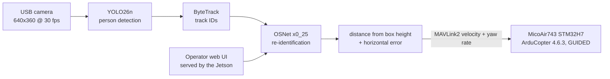

# Autonomous Person-Following F450 Quadcopter

A quadcopter that follows a person chosen by the operator, with **all vision processing on board**.
Senior capstone, Computer Engineering, UABC (Nov 2026). Jeffrey J. Yoon and Luis Alberto Godinez, advised by Dr. Adolfo Heriberto Ruelas Puente.

## Results (final flight, 2026-11-20)
| Metric | Requirement | Result |
|---|---|---|
| Continuous tracking in GUIDED | ≥ 60 s | **183.5 s**, target identified 96% of the time |
| Vision pipeline rate | ≥ 25 FPS | **median 31.3 FPS** (5th percentile 28.4), 23 ms latency |
| Re-identification after leaving the frame | same ID | **same ID after ~6.5 s** (cosine similarity 0.84); 12/13 ground tests |
| Horizontal centering error (RMS) | < 15% | **12.5%** |
| Works without Internet | yes | Jetson runs its own 5 GHz access point |

## How it works

- YOLO26n and OSNet run as **TensorRT FP16** engines on an **NVIDIA Jetson Xavier NX**.
- The operator picks the person's ID and follow distance (3–15 m) from a web page served by the Jetson.
- The Jetson only commands the drone when 5 conditions hold: heartbeat < 2 s, GUIDED mode, armed, radio link up, altitude ≥ 1.5 m. A safety pilot takes over with one switch.

## Repository
| Folder | What's inside |
|---|---|
| [`docs/capstone-report-es.pdf`](docs/capstone-report-es.pdf) | Full capstone report (Spanish, 59 pages): design, experiments, results, problems and solutions, cost analysis. |
| [`companion/`](companion) | `follow_person.py`: a condensed, readable version of the on-board tracking loop (YOLO + ByteTrack → pinhole distance → MAVLink velocity setpoints with the safety gate). The flight version adds OSNet re-ID, TensorRT engines and the web UI. |
| [`firmware/dron_f450_v4/`](firmware/dron_f450_v4) | Our own **ESP32-S3 flight controller** from the first phase of the project (v0): 250 Hz loop, cascaded PID with derivative-on-measurement, feed-forward and anti-windup, quaternion attitude from a BNO086 IMU, filtered BME688 barometer, GPS with quality gating, X-quad mixer with TPA and saturation handling, two-level radio failsafe. |
| [`firmware/control_f450_v3_1/`](firmware/control_f450_v3_1) | The ESP32 handheld remote that talks to the flight controller over ESP-NOW. |

## Hardware (final version)
F450 frame · MicoAir743 v2 (STM32H7) · AM32 ESCs · u-blox M10 GPS + compass · ExpressLRS radio · NVIDIA Jetson Xavier NX on its own battery · USB camera · 5200 mAh 4S battery · 1.6 kg, 4–5 min flights

## How we got here
| Version | What changed | Outcome |
|---|---|---|
| v0 | ESP32 flight controller with our own firmware (this repo), then Betaflight; ESP-NOW remote | Flew, but hard to stabilize |
| v1 | MicoAir743 + ArduPilot, GPS, ExpressLRS | Stable in Stabilize, AltHold and Loiter |
| v2 | Jetson pipeline on the ground, MAVLink over UART, tests against ArduPilot SITL | 26–31 FPS tracking on the ground |
| v3 | Full integration on board | Control losses traced to EKF sources and weight |
| v4 | GPS-based EKF, dedicated GUIDED switch | Autonomous tracking in the final test |

We fixed 20+ integration problems on the way: motor order and ESC startup, EKF source selection, compass interference, battery failsafe, Jetson power wiring, JetPack 5 flashing, UART console conflicts on the Jetson, building torchvision for CUDA arch 7.2, TensorRT export memory, and GStreamer library load order.

## Running the condensed tracker
```bash
cd companion
pip install -r requirements.txt
python3 follow_person.py --target-id 1 --distance 3.0 --port /dev/ttyTHS0
```
Fly only with a safety pilot on the radio and in an open area.
